# ВсОШ 2026/27 — информационная безопасность, 11 класс

Мой разбор десяти заданий школьного этапа: от обращения побайтового преобразования до статического анализа Windows-приложений.

Для каждого задания я записал исходную идею, ход решения и способ проверки. Скриншоты условий и заполненных ответов находятся в `images/`, скрипты — в `scripts/`, воспроизводимый вывод — в `evidence/`.

## Содержание

- [1. Сломанный пропуск](#task-01)
- [2. Самописный шифр](#task-02)
- [3. Стрелочник](#task-03)
- [4. Последний кадр](#task-04)
- [5. Поставлено на поток](#task-05)
- [6. Кто прочитает секрет?](#task-06)
- [7. Внутренний просмотрщик](#task-07)
- [8. По кусочкам](#task-08)
- [9. Свобода коровам!](#task-09)
- [10. Foolbox](#task-10)
- [Запуск скриптов](#reproduce)

## Ответы

| № | Задание | Ответ |
|---:|---|---|
| 1 | Сломанный пропуск | `vsosh{r3v3rs3_1s_c00l}` |
| 2 | Самописный шифр | `vsosh{m0d_1nv3rs3}` |
| 3 | Стрелочник | A: разрешено, правило 1; B и C: запрещено, правило 3; исправить правило 2 на `192.168.30.10:22` |
| 4 | Последний кадр | `vsosh{jpeg_eof_is_not_eof}` |
| 5 | Поставлено на поток | `monitor & collect \| filter >> alerts.log \|\| write_error >> errors.log` |
| 6 | Кто прочитает секрет? | alice, bob, dave → `showflag`; charlie → `sudo` |
| 7 | Внутренний просмотрщик | `fetch_preview`; суждения 1, 2, 5, 7; исправление 3 |
| 8 | По кусочкам | `vsosh{http_fragments_are_evidence}` |
| 9 | Свобода коровам! | `vsosh{Zh0rrk'nyaa_R'lyeh_d0y_ww}` |
| 10 | Foolbox | `vsosh{3x7en510n_ch3ck_6yp4ss}` |

<a id="task-01"></a>
## 1. Сломанный пропуск

**Тема:** reverse engineering исходного кода, XOR, циклические сдвиги.

В задании дан [C++-исходник](inputs/01-code.cpp), проверяющий введённую строку. Я начал с `verify`: длина должна совпадать с длиной массива `target`, каждый преобразованный байт — с соответствующим элементом массива, а в конце дополнительно проверяется контрольная сумма.

Преобразование одного символа выглядит так:

```cpp
c ^= static_cast<uint8_t>(0x2D + i * 7);
c = static_cast<uint8_t>((c << 3) | (c >> 5));
c = static_cast<uint8_t>(c + 0x31 - i);
```

Здесь `i` — позиция символа, начиная с нуля. Преобразования независимы для разных символов, поэтому строку можно восстанавливать побайтно.

### Как я обратил преобразование

Прямая цепочка:

```text
символ → XOR с маской → циклический сдвиг влево на 3 → прибавление
```

Я пошёл от известного результата к исходному байту:

1. Вычел прибавленное значение: `a = (target[i] - 0x31 + i) & 255`.
2. Выполнил циклический сдвиг вправо на 3 бита.
3. Повторил XOR с той же маской.

XOR обращается самим собой: `(x ^ k) ^ k == x`. Маска `& 255` воспроизводит хранение результата в `uint8_t`: остаются младшие восемь битов.

```python
target = bytes.fromhex(
    "0b 6a d1 b7 36 85 54 95 c1 22 2f 6e ba e2 18 51 37 5e fb 32 cb 09"
)

result = []
for i, y in enumerate(target):
    a = (y - 0x31 + i) & 255
    b = ((a >> 3) | (a << 5)) & 255
    result.append(b ^ ((0x2D + i * 7) & 255))

secret = bytes(result)
print(secret.decode())
```

### Проверка

Я пропустил результат через исходное преобразование и проверил каждый байт. Дополнительно вычислил:

```python
checksum = sum(c * (i + 3) for i, c in enumerate(secret))
assert checksum == 0x68CE
```

Получилась строка длиной 22 байта. Обе проверки прошли.

**Ответ:** `vsosh{r3v3rs3_1s_c00l}`.

[Полный скрипт](scripts/solve_01.py) · [Вывод проверки](evidence/task01-output.txt)

<details>
<summary>Скриншот задания и сохранённого ответа</summary>

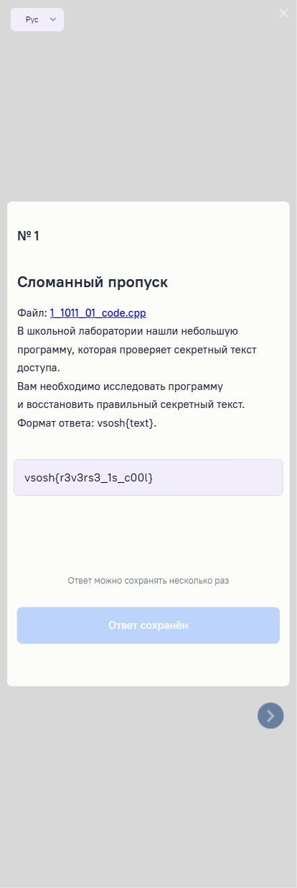

</details>

<a id="task-02"></a>
## 2. Самописный шифр

**Тема:** модульная арифметика, обращение аффинного преобразования.

Мне были даны [функция шифрования](inputs/02-encrypt.py) и [массив зашифрованных чисел](inputs/02-ciphertext.txt). Сначала каждый байт преобразуется по формуле:

```python
y = (73 * x + 41) % 257
```

Затем переворачивается каждый блок из четырёх элементов:

```python
for i in range(0, len(encrypted), 4):
    result.extend(encrypted[i:i + 4][::-1])
```

### Возвращение порядка элементов

Я сначала отменил последний этап шифрования. Повторное переворачивание каждого блока возвращает исходный порядок. Последний неполный блок тоже нужно развернуть — в файле он содержит два числа.

Например, первый блок `[212, 177, 212, 174]` превращается в `[174, 212, 177, 212]`.

### Обращение формулы

Из `y = 73*x + 41 (mod 257)` следует:

```text
x = (y − 41) × inverse(73) mod 257
```

Число, обратное к 73 по модулю 257, равно 169:

```text
73 × 169 = 12337 = 257 × 48 + 1
```

Значит, умножение на 169 отменяет умножение на 73 в этой модульной арифметике. В Python обратное число вычисляется через `pow(73, -1, 257)`.

```python
ordered = []
for i in range(0, len(encrypted), 4):
    ordered.extend(encrypted[i:i + 4][::-1])

inverse = pow(73, -1, 257)
secret = bytes(((y - 41) * inverse) % 257 for y in ordered)
print(secret.decode())
```

Первый символ получается так: `(174 - 41) * 169 % 257 == 118`, а байт 118 — это `v`.

### Проверка

Я заново зашифровал полученную строку: применил формулу и развернул блоки. Получился исходный массив из файла.

**Ответ:** `vsosh{m0d_1nv3rs3}`.

[Полный скрипт](scripts/solve_02.py) · [Вывод проверки](evidence/task02-output.txt)

<details>
<summary>Скриншот задания и сохранённого ответа</summary>

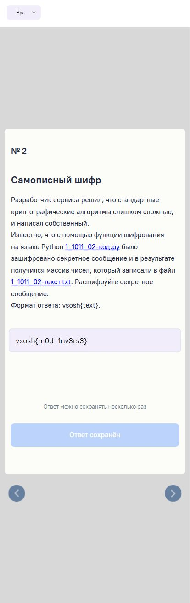

</details>

<a id="task-03"></a>
## 3. Стрелочник

**Тема:** DNAT, межсетевой экран, порядок обработки пакетов.

В условии явно сказано, что входящее соединение сначала проходит DNAT, а затем проверяется межсетевым экраном. Я выписал преобразования:

| Внешнее назначение | Назначение после DNAT |
|---|---|
| `203.0.113.10:8443/TCP` | `192.168.30.10:443/TCP` |
| `203.0.113.10:2222/TCP` | `192.168.30.10:22/TCP` |

Адрес источника при этом сохраняется. Следовательно, правила экрана должны сравнивать назначение уже с внутренним адресом и внутренним портом.

### Проверка трёх попыток

| Попытка | Источник | После DNAT | Фактический результат | Правило |
|---|---|---|---|---:|
| A | `198.51.100.20` | `192.168.30.10:443` | Разрешено | 1 |
| B | `198.51.100.150` | `192.168.30.10:22` | Запрещено | 3 |
| C | `198.51.100.80` | `192.168.30.10:22` | Запрещено | 3 |

Попытка A совпадает с первым разрешающим правилом: любой источник, внутренний сервер, TCP/443.

Попытка B приходит от администратора, но второе правило всё ещё проверяет `203.0.113.10:2222`. После DNAT такого назначения у пакета уже нет. Поэтому правило 2 не совпадает, и срабатывает общий запрет №3.

Попытка C тоже блокируется правилом 3: доступ по SSH с этого источника не разрешён.

### Исправление

Я выбрал ошибочное правило **2** и заменил два поля:

```text
Назначение: 192.168.30.10
Порт:      22
```

Источник `198.51.100.150` остаётся прежним. После исправления SSH разрешён только администратору.

Здесь важно было указать результат **исходной конфигурации**. Намерение администратора разрешить доступ ещё не означает, что текущее правило действительно его разрешает.

<details>
<summary>Скриншот заполненной таблицы и исправления</summary>

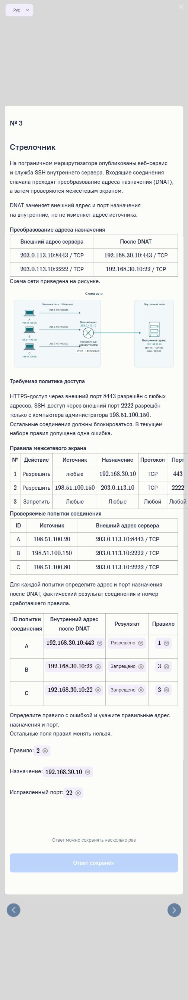

</details>

<a id="task-04"></a>
## 4. Последний кадр

**Тема:** файловая форензика, JPEG, данные после конца изображения.

В [JPEG-файле](inputs/04-photo.jpg) изображён простой пейзаж. Я начал с просмотра байтов и печатных строк, включая конец файла.


### Что оказалось после изображения

В предоставленном файле маркер окончания JPEG `FF D9` находится по смещению `0x53D4`. После него идёт перевод строки и такая последовательность:

```text
464c41473a76736f73687b6a7065675f656f665f69735f6e6f745f656f667d
```

Это ASCII-текст, содержащий шестнадцатеричную запись байтов. Первые пары дают:

| Hex | Символ |
|---|---|
| `46` | `F` |
| `4c` | `L` |
| `41` | `A` |
| `47` | `G` |
| `3a` | `:` |

Уже по началу `FLAG:` было понятно, что я нашёл нужные данные.

```python
from pathlib import Path

data = Path("inputs/04-photo.jpg").read_bytes()
eoi = data.rfind(b"\xff\xd9")
trailer = data[eoi + 2:].strip()
print(bytes.fromhex(trailer.decode("ascii")).decode("ascii"))
```

Результат:

```text
FLAG:vsosh{jpeg_eof_is_not_eof}
```

Просмотрщик JPEG отображает изображение, а дописанный текст не становится частью картинки. Это объясняет, почему визуально файл не выдаёт секрет.

В этом конкретном файле хвост — обычный ASCII-текст, поэтому поиск последнего `FF D9` подходит. Для произвольного повреждённого или специально устроенного JPEG корректнее разбирать структуру формата.

**Ответ:** `vsosh{jpeg_eof_is_not_eof}`.

[Полный скрипт](scripts/solve_04.py) · [Вывод проверки](evidence/task04-output.txt)

<details>
<summary>Скриншот задания и сохранённого ответа</summary>

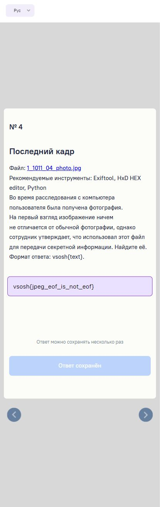

</details>

<a id="task-05"></a>
## 5. Поставлено на поток

**Тема:** Bash, конвейеры, фоновые процессы, условное выполнение.

Я сопоставил каждому требованию подходящий оператор:

| Требование | Оператор |
|---|---|
| Запустить `monitor` в фоне | `&` |
| Передать вывод `collect` на вход `filter` | `\|` |
| Дописать результат в существующий журнал | `>>` |
| Выполнить команду при ошибке предыдущей | `\|\|` |

Из этого получается одна строка:

```bash
monitor & collect | filter >> alerts.log || write_error >> errors.log
```

### Разбор выполнения

1. `monitor &` запускает наблюдение в фоне. Оболочка продолжает выполнение следующей команды.
2. `collect | filter` соединяет стандартный вывод сборщика со стандартным вводом фильтра.
3. `>> alerts.log` дописывает стандартный вывод `filter` в журнал подозрительных событий.
4. `|| write_error` запускает печать ошибки, если код завершения конвейера ненулевой.
5. `>> errors.log` дописывает стандартный вывод `write_error` в журнал ошибок.

В условии отдельно оговорено, что `pipefail` выключен. Поэтому код конвейера равен коду последней команды, то есть `filter`. Именно его ошибка и запускает `write_error`.

Использование `>` уничтожило бы прежнее содержимое журнала, а `&&` запускало бы команду после успешного выполнения. Оба варианта не соответствуют условию.

В интерфейсе я выбрал:

| Поле | Значение | Поле | Значение |
|---|---|---|---|
| Текст 1 | `monitor` | Оператор 1 | `&` |
| Текст 2 | `collect` | Оператор 2 | `\|` |
| Текст 3 | `filter` | Оператор 3 | `>>` |
| Текст 4 | `alerts.log` | Оператор 4 | `\|\|` |
| Текст 5 | `write_error` | Оператор 5 | `>>` |
| Текст 6 | `errors.log` | — | — |

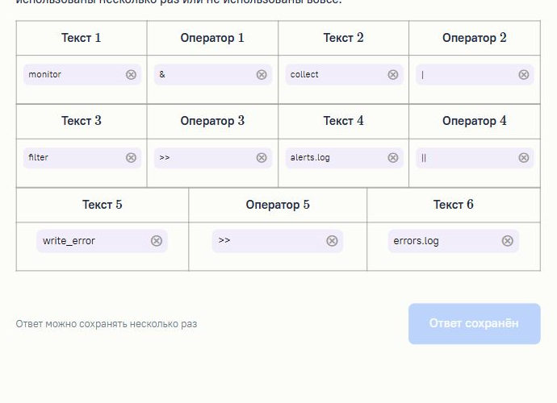

<details>
<summary>Полный скриншот условия</summary>

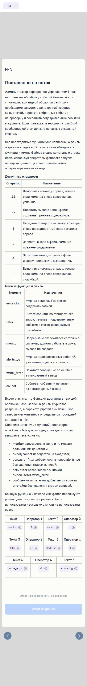

</details>

<a id="task-06"></a>
## 6. Кто прочитает секрет?

**Тема:** права доступа Linux, группы, sudo, SUID.

В этой задаче я отдельно проверял доступ к каталогу, доступ к файлу и возможность запустить программу с другими эффективными правами.

### Каталог и файл

```text
drwxr-x--- root dev   /opt/olymp
-rw-r----- root audit /opt/olymp/flag.txt
```

ACL файла содержит только обычные записи:

```text
user::rw-
group::r--
other::---
```

Для чтения по известному пути необходимо иметь `x` на каталоге и `r` на файле. Право `x` на каталоге позволяет проходить через него к объектам внутри.

| Пользователь | Дополнительная группа | Проход через `/opt/olymp` | Чтение самого файла | Обычный `cat` |
|---|---|---|---|---|
| alice | `dev` | Да | Нет | Нет |
| bob | `audit` | Нет | Да | Нет |
| charlie | Нет | Нет | Нет | Нет |
| dave | `dev` | Да | Нет | Нет |

Ни у одного пользователя одновременно нет обоих необходимых разрешений.

### Дополнительные способы

Для charlie есть разрешение в `sudoers`:

```text
charlie ALL=(root) NOPASSWD: /bin/cat /opt/olymp/flag.txt
```

Поэтому он может прочитать файл указанной командой от root.

Программа `showflag` имеет права:

```text
-rwsr-xr-x root root /usr/local/bin/showflag
```

Буква `s` в позиции выполнения владельца означает SUID. При запуске этой исполняемой программы эффективным UID становится UID её владельца — root. По условию программа выводит содержимое нужного файла, а запуск разрешён всем четырём пользователям.

### Итоговое соответствие

| Пользователь | Выбранный способ |
|---|---|
| alice | `/usr/local/bin/showflag` |
| bob | `/usr/local/bin/showflag` |
| charlie | Разрешённая команда `sudo` |
| dave | `/usr/local/bin/showflag` |

У charlie доступны `sudo` и `showflag`, но условие требует выбрать первый доступный способ в порядке `cat → sudo → showflag`. Поэтому я связал его с `sudo`. Одинаковый результат можно использовать для нескольких пользователей; варианты про обычный `cat` и полную недоступность остаются без связей.

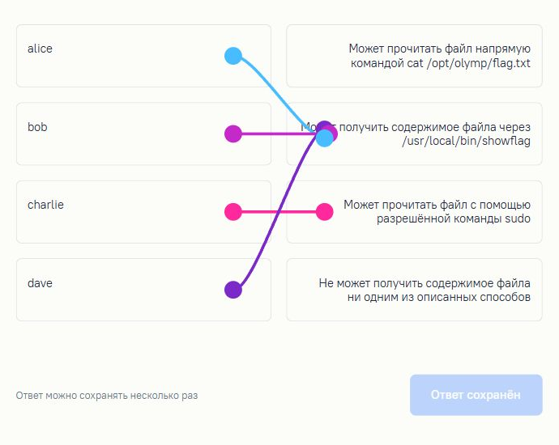

<details>
<summary>Полный скриншот условия</summary>

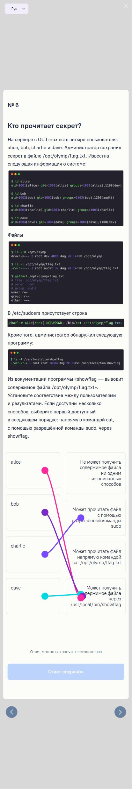

</details>

<a id="task-07"></a>
## 7. Внутренний просмотрщик

**Тема:** анализ исходного кода веб-приложения, SSRF.

В [Python-коде](inputs/07-code.py) я проследил путь параметра `url`:

```python
@app.route("/preview")
def preview():
    url = request.args.get("url", "")
    result = fetch_preview(url)
```

Далее `fetch_preview` проверяет схему URL, определяет IP-адрес имени хоста и выполняет запрос:

```python
parsed = urlparse(url)
target_ip = resolve_host(parsed.hostname)

if target_ip is None:
    return {"error": "Host cannot be resolved"}

response = urlopen(url, timeout=2)
body = response.read(300)
```

### Где проблема

`target_ip` проверяется только на `None`: приложение убеждается, что имя можно разрешить, но не ограничивает допустимые адреса назначения. Проверка схемы `http`/`https` также не запрещает HTTP-сервис внутри локальной сети.

В результате клиент выбирает адрес, а сетевое соединение устанавливает сервер. Клиент может получить часть ответа ресурса, доступного серверу. Это SSRF — Server-Side Request Forgery.

В поле функции я указал **`fetch_preview`**: именно в ней находится выполнение запроса по недостаточно ограниченному пользовательскому URL. `preview` передаёт в неё ввод пользователя.

### Верные суждения

| № | Суждение | Оценка |
|---:|---|---|
| 1 | Запрос выполняет сервер | Верно |
| 2 | Потенциально доступны ресурсы внутренней сети | Верно |
| 3 | Одного ограничения схемами HTTP(S) достаточно | Неверно |
| 4 | Обязательно нужна учётная запись администратора | Неверно |
| 5 | Возможна выдача информации от внутренних сервисов | Верно |
| 6 | URL выполняет браузер пользователя с правами сервера | Неверно |
| 7 | Для защиты подходит список разрешённых адресов/доменов | Верно |

Я отметил **1, 2, 5 и 7**. В вопросе об исправлении выбрал **вариант 3**: заранее определённые безопасные адреса/домены и дополнительная блокировка внутренних и специальных IP-адресов.

Для реальной реализации такой защиты нужно учитывать разрешение DNS и перенаправления: ограничение должно сохраняться для фактических адресов, к которым будет обращаться сервер.

<details>
<summary>Скриншот выбранных суждений и способа защиты</summary>

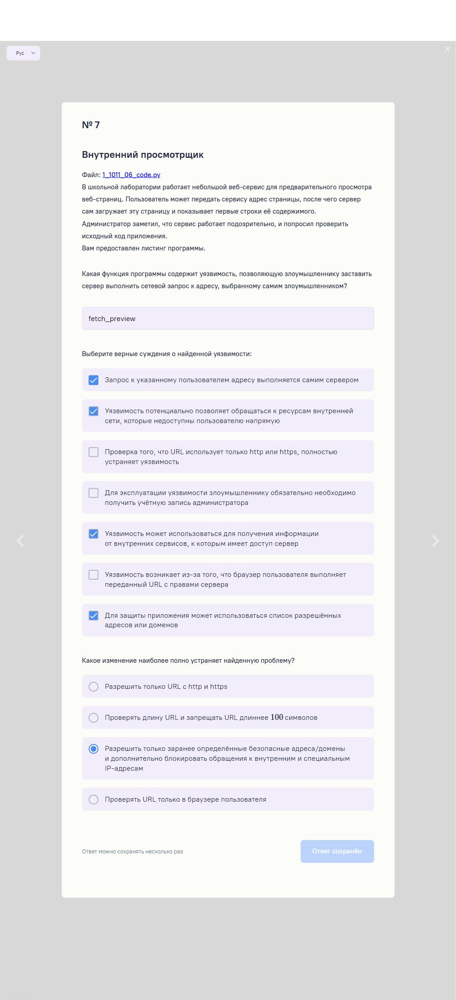

</details>

<a id="task-08"></a>
## 8. По кусочкам

**Тема:** анализ PCAP, HTTP, сборка фрагментов, Base64.

В [дампе трафика](inputs/08-traffic.pcap) я нашёл несколько HTTP POST-запросов к `/upload`. Их тела имеют вид:

```text
id=1&total=7&data=dnNvc2h
```

Поля явно описывают фрагментированную передачу: `id` — номер части, `total` — общее количество, `data` — содержимое.

### Почему порядок пакетов не подходит

В дампе части пришли в таком порядке:

```text
1, 6, 4, 2, 3, 7, 5
```

Я собрал их по номерам:

| `id` | `data` |
|---:|---|
| 1 | `dnNvc2h` |
| 2 | `7aHR0cF` |
| 3 | `9mcmFnb` |
| 4 | `WVudHNf` |
| 5 | `YXJlX2V` |
| 6 | `2aWRlbm` |
| 7 | `NlfQ==` |

После склейки получилось:

```text
dnNvc2h7aHR0cF9mcmFnbWVudHNfYXJlX2V2aWRlbmNlfQ==
```

Алфавит и окончание `==` указывают на Base64. Я декодировал всю строку целиком:

```python
import base64

encoded = "".join(parts[i] for i in range(1, 8))
secret = base64.b64decode(encoded, validate=True)
print(secret.decode())
```

Каждую часть по отдельности декодировать не нужно: границы фрагментов не совпадают с границами четвёрок символов Base64.

### Проверка и особенности PCAP

Я проверил, что присутствуют все номера от 1 до 7, а повторное кодирование даёт ту же Base64-строку.

У этого PCAP тип канального уровня — **228, LINKTYPE_IPV4**. Пакеты начинаются прямо с IPv4-заголовка; пропускать 14 байт Ethernet здесь нельзя. Каждый нужный HTTP-запрос целиком помещается в один TCP payload. Это позволяет извлечь запросы простым парсером. Для произвольного дампа с разбитыми запросами потребовалась бы сборка TCP-потоков.

**Ответ:** `vsosh{http_fragments_are_evidence}`.

[Полный парсер и решатель](scripts/solve_08.py) · [Вывод с порядком частей](evidence/task08-output.txt)

<details>
<summary>Скриншот задания и сохранённого ответа</summary>

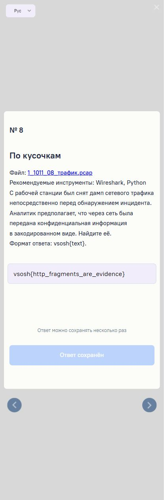

</details>

<a id="task-09"></a>
## 9. Свобода коровам!

**Тема:** статический анализ PE, поиск констант, AES-256-GCM.

По сюжету нужно было узнать секретное имя коровы из приложения учёта надоя. Для получения ответа я использовал статический разбор Windows-версии: прочитал её как файл и восстановил операцию расшифровки отдельным Python-скриптом.

### Как я нашёл нужный участок

1. Извлёк печатные строки EXE. В них были пути сборки Rust, названия библиотек и строка `src/server/flag.rs`.
2. Разобрал PE-заголовки и секции через `pefile`.
3. Использовал `capstone`, чтобы прочитать машинные инструкции и ссылки на данные.
4. Нашёл функцию по предпочтительному виртуальному адресу **`0x1400A29D0`**.

Имена исходных файлов в строках служат ориентирами. Полного Rust-исходника внутри EXE не было.

Важный фрагмент функции:

```asm
lea  rdx, [rip + ...]   ; 0x14030CFA0: зашифрованные данные
lea  r9,  [rip + ...]   ; 0x14030CFD0: nonce
mov  r8d, 0x30         ; 48 байт
call 0x14012B120       ; расшифровка
```

По реализации криптографической функции и используемым данным я восстановил AES-256-GCM. Затем нашёл встроенный 32-байтовый ключ.

### Извлечённые данные

Смещения ниже относятся к файлу на диске. Виртуальные адреса указаны для `ImageBase = 0x140000000`.

| Данные | Смещение в файле | Предпочтительный VA | Размер |
|---|---:|---:|---:|
| Ключ | `0x30989A` | `0x14030AA9A` | 32 байта |
| Шифротекст вместе с тегом | `0x30BDA0` | `0x14030CFA0` | 48 байт |
| Nonce | `0x30BDD0` | `0x14030CFD0` | 12 байт |

```text
key:
6cf197aa99d99a55f47b30adc37db165107397c2d178c5c5f9d044b32608ae53

nonce:
dd8d0f16c38cfe68208be43a

ciphertext + tag:
b66de67eba6b1dd8de0bc41744d932419d7fb5849bfbbe41c85c8cb88f2c5b4b
5efb8ffdcbac3c6ae1148c3451fc4636
```

В контейнере 32 байта шифротекста и 16 байт тега подлинности.

### Расшифровка и проверка

```python
from pathlib import Path
from Crypto.Cipher import AES

data = Path("1_1011_09-windows.exe").read_bytes()
key = data[0x30989A:0x3098BA]
encrypted = data[0x30BDA0:0x30BDD0]
nonce = data[0x30BDD0:0x30BDDC]

secret = AES.new(key, AES.MODE_GCM, nonce=nonce).decrypt_and_verify(
    encrypted[:-16], encrypted[-16:]
)
print(secret.decode())
```

`decrypt_and_verify` успешно проверил тег. Это подтверждает, что ключ, nonce и данные согласованы. Наличие ключа в том же EXE позволило выполнить обычную расшифровку AES отдельной библиотекой.

**Ответ:**

```text
vsosh{Zh0rrk'nyaa_R'lyeh_d0y_ww}
```

Это решение через статический анализ. Доказательство SQL-инъекции в приложении для получения этого ответа не использовалось.

**SHA-256 исходного EXE:**

```text
61f2080ae2860f6e7bf437884467eae1ceb2945fed55571425baa8099639bacb
```

[Решатель](scripts/solve_09.py) · [Вывод с проверкой GCM](evidence/task09-output.txt) · [Фрагмент дизассемблирования](evidence/task09-asm-a1dd0.txt)

<details>
<summary>Скриншот задания и сохранённого ответа</summary>

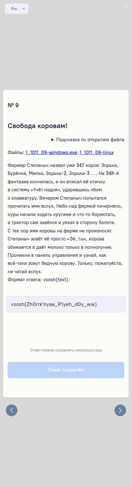

</details>

<a id="task-10"></a>
## 10. Foolbox

**Тема:** статический анализ обработчика изображений, встроенные ключи AES-GCM.

В задании предоставлен локальный сервис для манипуляций с изображениями. Я исследовал его EXE статически. По строкам обнаружились обработчики `/tools/bitmap`, `/tools/strings`, `/tools/invert`, `/tools/imprint`, `/tools/cowify` и имя исходного файла `src/server/flag.rs`.

### Что я проследил в машинном коде

Нужная логика оказалась встроена компилятором в более крупную функцию. Я проследил загрузку ключа, копирование зашифрованных байтов и проверку тега.

В отличие от №9, здесь нельзя просто брать соседние байты после шифротекста в качестве nonce: рядом лежит ключ, а nonce находится в другой области `.rdata`.

Наблюдения по инструкциям:

- по адресу `0x14004E3AD` загружается ссылка на первую половину ключа `0x1401FC0CD`;
- затем используется вторая половина по адресу `0x1401FC0DD`;
- `mov edx, 0x2D` задаёт размер буфера 45 байт;
- инструкции около `0x14004F500` копируют в него шифротекст с тегом из `0x1401FC0A0`;
- инструкция по адресу `0x14004F527` загружает константу, содержащую nonce из `0x1401F2210`.

### Таблица данных

| Данные | Смещение в файле | Предпочтительный VA | Размер |
|---|---:|---:|---:|
| Ключ | `0x1FA8CD` | `0x1401FC0CD` | 32 байта |
| Шифротекст вместе с тегом | `0x1FA8A0` | `0x1401FC0A0` | 45 байт |
| Nonce | `0x1F0A10` | `0x1401F2210` | 12 байт |

```text
key:
a07e70637f61cb01ff131ff8820e5e19fbf71275225259b26ee0dc85222db354

nonce:
5f17ae5de4a2d6b711ded3ec

ciphertext + tag:
1b67aa11206b6f0b967ad7efa609f79bdf2f88168a74f194f333b7af548a58b7
9cc74b81b5c2930cf9dcffe1d0
```

Здесь 29 байт шифротекста и 16 байт тега.

### Получение флага

```python
from pathlib import Path
from Crypto.Cipher import AES

data = Path("1_1011_10-windows.exe").read_bytes()
key = data[0x1FA8CD:0x1FA8ED]
nonce = data[0x1F0A10:0x1F0A1C]
encrypted = data[0x1FA8A0:0x1FA8CD]

secret = AES.new(key, AES.MODE_GCM, nonce=nonce).decrypt_and_verify(
    encrypted[:-16], encrypted[-16:]
)
print(secret.decode())
```

Проверка тега подлинности прошла успешно.

**Ответ:**

```text
vsosh{3x7en510n_ch3ck_6yp4ss}
```

Название флага намекает на обход проверки расширения. В этом разборе я фиксирую подтверждённый статический способ получения секрета; цепочку эксплуатации сервиса через загрузку изображений я не воспроизводил.

**SHA-256 исходного EXE:**

```text
cd7e901210cc5e163f95cfa55950186275f22a1c5d7e146aaef2d72a254da674
```

[Решатель](scripts/solve_10.py) · [Вывод с проверкой GCM](evidence/task10-output.txt) · [Загрузка ключа](evidence/task10-asm-4d7ad.txt) · [Загрузка шифротекста и nonce](evidence/task10-asm-4e8e4.txt)

<details>
<summary>Скриншот условия</summary>

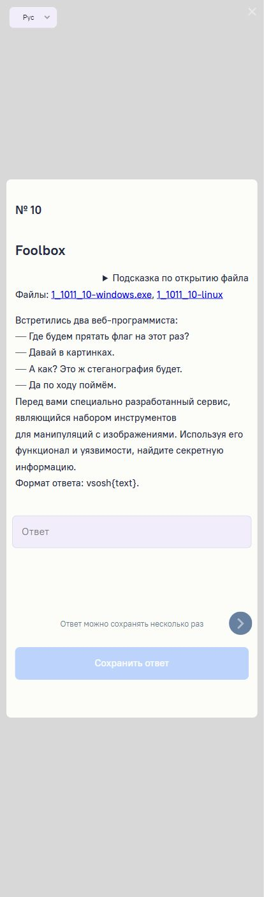

</details>

<a id="reproduce"></a>
## Запуск скриптов

Для воспроизведения использован Python 3.13. Скрипты №1, №2, №4 и №8 работают на стандартной библиотеке. Для №9 и №10 нужен `pycryptodome`; для дизассемблирования — `pefile` и `capstone`. Точные проверенные версии записаны в [requirements.txt](requirements.txt).

```bash
python -m venv .venv
```

Активация в PowerShell:

```powershell
.\.venv\Scripts\Activate.ps1
```

Активация в Bash:

```bash
source .venv/bin/activate
```

Установка зависимостей и запуск из корня репозитория:

```bash
python -m pip install -r requirements.txt
python scripts/solve_01.py
python scripts/solve_02.py
python scripts/solve_04.py
python scripts/solve_08.py
```

Исполняемые файлы заданий в репозиторий не включены. После скачивания оригиналов их пути передаются аргументом:

```bash
python scripts/solve_09.py path/to/1_1011_09-windows.exe
python scripts/solve_10.py path/to/1_1011_10-windows.exe
```

Эти решатели только читают EXE как массив байтов. Перед извлечением они проверяют SHA-256: смещения рассчитаны для конкретных файлов и не обязаны подходить к другим сборкам.

### Как повторить часть статического анализа

В [inspect_pe.py](scripts/inspect_pe.py) я оставил небольшую утилиту для поиска строк, RIP-relative ссылок и дизассемблирования. Примеры для Windows-версии №9:

```bash
python scripts/inspect_pe.py path/to/1_1011_09-windows.exe --find src/server/flag.rs
python scripts/inspect_pe.py path/to/1_1011_09-windows.exe --xref 0x30BDA0
python scripts/inspect_pe.py path/to/1_1011_09-windows.exe --disasm 0xA1DD0 --length 0x60
```

И для №10:

```bash
python scripts/inspect_pe.py path/to/1_1011_10-windows.exe --xref 0x1FA8A0
python scripts/inspect_pe.py path/to/1_1011_10-windows.exe --disasm 0x4D7AD --length 0x42
python scripts/inspect_pe.py path/to/1_1011_10-windows.exe --disasm 0x4E8E4 --length 0x52
```

Утилита ищет прямые RIP-relative обращения в исполняемых секциях. Это полезная часть анализа, но косвенные ссылки и динамически вычисляемые адреса требуют отдельного разбора.

### Структура репозитория

```text
.
├── README.md
├── requirements.txt
├── images/       # Скриншоты условий и ответов
├── inputs/       # Предоставленные текстовые файлы, JPEG и PCAP
├── scripts/      # Решатели и утилита статического анализа
└── evidence/     # Фактический вывод скриптов и фрагменты дизассемблирования
```

## Что я вынес из этих заданий

В №1 и №2 помогло обращение операций в обратном порядке. В №3, №5 и №6 нужно было буквально проследить порядок действий и проверок. В №4 и №8 секрет восстанавливался из структуры файлов и протокола передачи. В №7 достаточно было проследить пользовательский ввод до сетевого запроса. В №9 и №10 ключевым оказался поиск встроенных констант и проверяемая расшифровка.

Во всех файловых задачах я проверял полученный результат: прямым преобразованием, полнотой фрагментов или тегом подлинности. Это позволяло отличить подходящую на вид строку от подтверждённого решения.
